<div align="center">

<a href="https://www.axel-diaz.com">
  
</a>

</div>

```
╔══════════════════════════════════════════════════════════════════╗
║  ¡Hola! Soy Axel, desarrollador full stack en Colima, México.    ║
║  Trabajo con Ruby on Rails y Vue 3: APIs, colas con Sidekiq y    ║
║  pantallas que la gente usa todos los días. Fuera del trabajo    ║
║  hago apps nativas para Mac, herramientas para Windows y le      ║
║  muevo a mi servidor casero.                                  ▼  ║
╚══════════════════════════════════════════════════════════════════╝
```

### ⚔️ Misiones

| | Proyecto | Qué es | Stack |
|:-:|---|---|---|
| ★ | **[Plantelia](https://plantelia.axel-diaz.com)** | Control escolar para primarias y secundarias: asistencias con QR, calificaciones, expedientes y avisos a familias. Funciona sin internet. | Rails · Vue 3 · PostgreSQL · Sidekiq · PWA |
| ◆ | **[NotchFlow](https://github.com/AxelRGDiaz/NotchFlow)** | El notch de la MacBook convertido en panel: música, calendario, tareas, bandeja con AirDrop y temporizador. | Swift 6 · SwiftUI |
| ◆ | **[ClatuaTech Tools](https://github.com/AxelRGDiaz/clatuaTools)** | Navaja suiza para técnicos de Windows: instala programas con winget, diagnostica y repara el sistema desde una ventana. | Electron · React · TypeScript |
| ◆ | **[Converter App](https://k8s.axel-diaz.com)** | Convierte video, audio, imágenes y documentos en cola; el avance llega en vivo al navegador. | Rails · Sidekiq · Turbo Streams · ffmpeg |
| ◆ | **[axel-diaz.com](https://github.com/AxelRGDiaz/axelDiaz-webSite)** | Mi portafolio, hecho como un RPG de Game Boy. | Next.js · TypeScript |

<sub>★ misión principal &nbsp;·&nbsp; ◆ misión secundaria &nbsp;·&nbsp; casos de estudio completos en <a href="https://www.axel-diaz.com">axel-diaz.com</a></sub>

### 🎒 Inventario

<p>
  
  <br/>
  
</p>

- **Diario:** Ruby on Rails, Vue 3, MySQL, Git
- **Seguido:** Sidekiq + Redis, PostgreSQL, Docker, TypeScript
- **De vez en cuando:** Node.js, Swift, Electron, Rust

### 📜 Bitácora

```
2021 ── Ingeniería en Tecnologías del Internet · Universidad de Colima
2021 ── Técnico por mi cuenta: reparación, redes y talleres de robótica
2024 ── Full stack remoto en Mobysuite · Rails, Vue 3, Sidekiq, MySQL
2026 ── Lanzo Plantelia                                  ◀ partida actual
```

### 💾 Guardar partida

<p>
  <a href="https://www.axel-diaz.com"></a>
  <a href="https://www.linkedin.com/in/axel-diaz24/"></a>
  <a href="mailto:axelrgdiaz@gmail.com"></a>
</p>

<div align="center">
  <br/>
  
</div>
